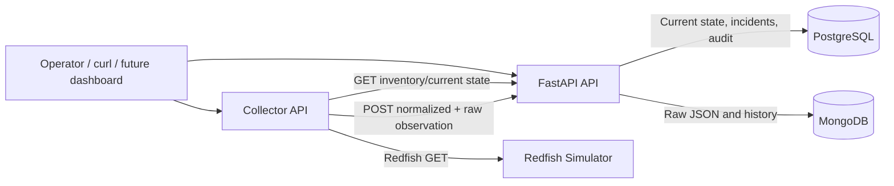

# ServerOps Platform

ServerOps Platform is a local infrastructure monitoring and incident-management lab.
It demonstrates practical DevOps skills using simulated Redfish servers, Python,
FastAPI, PostgreSQL, MongoDB, Docker Compose, automated incident creation, and audit logs.

> This repository must contain only synthetic data. Do not add employer hostnames,
> IP addresses, screenshots, credentials, logs, code, or internal documentation.

## MVP scope

The first milestone proves one complete workflow:

1. Register a simulated server.
2. Scan its Redfish endpoint.
3. Store the raw observation in MongoDB.
4. Store the current operational state in PostgreSQL.
5. Change the simulated disk health to `Critical`.
6. Scan again.
7. Create one idempotent `DISK_FAILURE` incident.
8. Restore disk health.
9. Scan again and automatically resolve the incident.
10. Record observation, incident-open, and incident-resolve actions in the audit log.

Prometheus, Grafana, Kubernetes, CI/CD, Terraform, and Argo CD are deliberately excluded
from this milestone. They will be added only after the MVP is stable.

## Architecture



## Data ownership

| Data | Database | Reason |
|---|---|---|
| Server inventory and current state | PostgreSQL | Relational constraints, uniqueness, transactions |
| Incident lifecycle | PostgreSQL | Consistent state transitions and queries |
| Audit log | PostgreSQL | Ordered, queryable operational record |
| Raw Redfish payloads | MongoDB | Source payloads can vary between vendors and firmware |
| Historical observations | MongoDB | Append-oriented documents without forcing one rigid schema |

PostgreSQL is the source of truth for current state. MongoDB is the evidence/history store.

## Repository layout

```text
serverops-platform/
├── api/                       # FastAPI backend
├── collector/                 # Redfish collector and change detector
├── dashboard/                 # Reserved for phase 2
├── tests/                     # Unit tests
├── database/                  # Future migrations and database docs
├── docker/                    # Docker-specific support files
├── kubernetes/                # Reserved for phase 4
├── helm/                      # Reserved for later packaging
├── terraform/                 # Reserved for phase 6
├── argocd/                    # Reserved for phase 7
├── monitoring/                # Reserved for phase 3
├── simulators/redfish/        # Minimal Redfish-compatible simulator
├── scripts/                   # Setup and demo scripts
├── docs/                      # Architecture and setup documentation
├── diagrams/                  # Diagram sources
├── .github/workflows/         # Reserved for phase 5
├── docker-compose.yml
├── .env.example
├── Makefile
└── README.md
```

## Quick start

### 1. Prepare configuration

```bash
cp .env.example .env
nano .env
```

Replace both example passwords.

### 2. Start the platform

```bash
docker compose up --build -d
docker compose ps
```

### 3. Register the demo server

```bash
./scripts/register-demo-server.sh
```

### 4. Run the complete demo

```bash
./scripts/demo.sh
```

## Manual demo

```bash
# Healthy scan
curl -X POST http://localhost:8001/scan

# Simulate a disk failure
curl -X POST http://localhost:9000/control/disk-failure
curl -X POST http://localhost:8001/scan

# View incidents
curl http://localhost:8000/api/v1/incidents

# Repair the disk and resolve the incident
curl -X POST http://localhost:9000/control/disk-healthy
curl -X POST http://localhost:8001/scan
curl http://localhost:8000/api/v1/incidents

# View audit records
curl http://localhost:8000/api/v1/audit-logs
```

## Endpoints

| Service | URL |
|---|---|
| API Swagger | http://localhost:8000/docs |
| API health | http://localhost:8000/health |
| Collector health | http://localhost:8001/health |
| Redfish simulator | http://localhost:9000/redfish/v1/Systems/1 |

## Tests

```bash
python3 -m venv .venv
source .venv/bin/activate
pip install -r requirements-dev.txt
pytest
ruff check .
```

## Acceptance criteria

The MVP is complete only when all of the following are true:

- All five containers are healthy.
- One server can be registered through the API.
- A healthy scan updates `last_seen_at` without opening an incident.
- A disk-failure scan opens exactly one active incident.
- Repeated failed scans do not create duplicate incidents.
- A healthy scan resolves the active disk incident.
- Raw observations exist in MongoDB.
- Current state, incidents, and audit records exist in PostgreSQL.
- Unit tests pass.

## Troubleshooting

### Compose reports missing variables

Create `.env` from `.env.example` and replace the example passwords.

### Docker commands require sudo

Add the user to the Docker group, then log out and back in:

```bash
sudo usermod -aG docker "$USER"
```

### API starts before a database is ready

Check container health and logs:

```bash
docker compose ps
docker compose logs postgres mongo api
```

### Reset all local data

```bash
docker compose down -v
```

This permanently removes the local PostgreSQL and MongoDB volumes.
