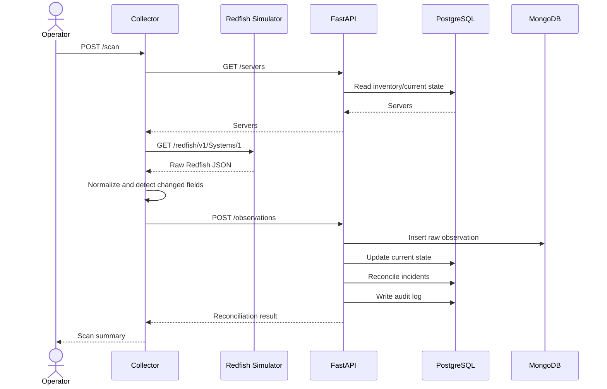

# MVP Architecture

## Boundaries

- The collector is read-only toward monitored systems.
- The API owns business rules and database writes.
- PostgreSQL owns current operational truth.
- MongoDB preserves source evidence and flexible historical payloads.
- The simulator is isolated synthetic infrastructure.
